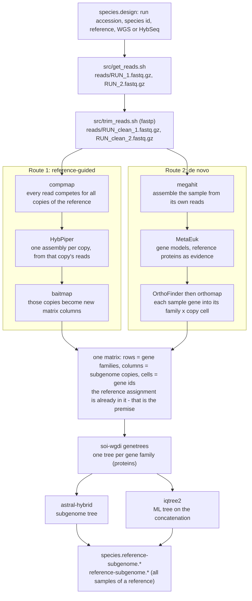

## Table of Contents

   * [What it does](#what-it-does)
   * [Input data](#input-data)
   * [Installation](#installation)
   * [Step 0: get the reads](#step-0-get-the-reads)
   * [Route 1: reference-guided](#route-1-reference-guided)
   * [Route 2: de novo](#route-2-de-novo)
   * [Outputs](#outputs)
   * [The example data](#the-example-data)
   * [FAQ](#faq)

### What it does ###

A polyploid lineage keeps several **subgenomes**: after a whole-genome duplication it carries
two, three or five copies of most genes, one copy per subgenome. For one reference species
those copies have already been assigned, and that assignment is the starting point here: the
file `pre-study/merged.alignment.csv`, described under *Input data*.

The question this repository answers is narrower than "are there several subgenomes": **does
a species known only from sequencing reads share that duplication?** If it does, its genes
should fall into the same subgenomes, i.e. each of its copies should be sister to the
corresponding copy of the reference instead of the sample's copies being sisters to each
other.

So the work is (i) to decide, for every reference gene family, which copy a read-derived
sequence of the sample belongs to, and (ii) to build trees that show whether that assignment
recovers the reference's subgenomes. Two routes do (i) differently:

| route | idea | script |
|---|---|---|
| 1, reference-guided | reads compete for all copies of the reference; a read is assigned to at most one copy, that copy is assembled from those reads, and `baitmap` carries the result into the matrix | `pipeline-refguided.sh` |
| 2, de novo | the sample is assembled and annotated on its own, and its genes are assigned to the copies by orthology | `pipeline-denovo.sh` |

Route 1 keeps the depth information and is the route that tests the duplication. Route 2 does
not use the reference for assembly at all, only afterwards for the assignment; with target
capture (HybSeq) reads its assembly covers only the captured genes, so the result is limited
to them. Both routes write the same matrix format, so samples of both can end up in one tree.



Same start, same end: the routes differ only in how a sample gene is given its subgenome label —
by competition over the reference copies (route 1) or by orthology after assembling the sample on
its own (route 2).

Every step below is a loop over `species.design`, and the two `pipeline-*.sh` scripts are
those loops in order plus one combined tree per reference. Read the steps to understand what
happens; run the scripts when you have many samples.

### Input data ###

One file drives everything, `species.design`: four columns, TAB separated, **no header, no
comments**, one line per sample:

```
SRR34069007	Triplochiton_scleroxylon	Reevesia_pubescens	WGS
ERR7599640	Ungeria_floribunda	Reevesia_pubescens	HybSeq
```

1. **col1, run accession** — locates the reads at ENA/NCBI. If you already have filtered reads,
   name them `reads/<col1>_clean_1.fastq.gz` and `_clean_2.fastq.gz` and skip Step 0 entirely.
   Single-end data is fine too: only `reads/<col1>_clean_1.fastq.gz` needs to exist, and every
   step then runs on that one file.
2. **col2, species id** — the label of this sample in the output. Matrix columns become
   `<species id>_<subgenome>`; de novo gene ids become `<species id>|g000001`. A species
   sequenced twice needs two ids (`_WGS`, `_1`, `_2`).
3. **col3, reference species** — whose subgenome copies are columns of the matrix. These
   copies are the baits (route 1) and the assignment target (route 2).
4. **col4, library type** — `WGS` or `HybSeq`; only printed with the log line, it tells the
   reader how far the assembly of route 2 can reach.

The reference side is the directory `pre-study/`:

| file | content |
|---|---|
| `merged.alignment.csv` | subgenome-assigned matrix, the output format of `wgdi -a`: one row per gene family, one **column per subgenome copy**, a cell = gene id or empty |
| `rename.list` | column names of that matrix, line *n* = column *n*, name = the second field (the first is just a running number) |
| `pep.faa` / `cds.fa` | proteins / CDS of every gene id that appears in the matrix |
| `all_species_gene.gff` | `contig  gene  start  end  strand` — only needed to split trees by chromosome |

How this matrix and the other `pre-study/` files are built:
https://github.com/zhangrengang/subgenome_phasing_example

col3 is not a free label — it is the **prefix of the copy columns in `rename.list`**: the copies
of a reference are the columns named `<col3>_<subgenome>` (the last `_` splits species from
subgenome), and the outgroup passed to the tree step is a column name exactly as written there.
With the example design that means `rename.list` must contain `Reevesia_pubescens_R`,
`Reevesia_pubescens_H` and `Theobroma_cacao`:

```
cut -f2 pre-study/rename.list | grep -E '^Reevesia_pubescens_|^Theobroma_cacao$'
```

For your own matrix, col3 and the outgroup are read **from these column names** — not guessed
from the species you happen to have sequenced.

One matrix = one reference species: `merged.alignment.csv` holds the copies of a single
reference, so a design run is per reference. Samples of another reference need their own matrix
and their own run.

Two conventions are used everywhere:

- gene ids are `<species>|<gene id>` (the `|` separator is what OrthoFinder and the tree tools
  expect);
- a copy column is named `<species>_<subgenome>`, e.g. `Reevesia_pubescens_R` and
  `Reevesia_pubescens_H`; a species without copies (the outgroup, `Theobroma_cacao`) is a
  single column. The labels are free — `_A/_B/_C` works the same way.

### Installation ###

Two sources, and they do not overlap: the conda environment gives the **tools**, while
`soi-wgdi` itself is installed from the [SOI](https://github.com/zhangrengang/SOI) source tree
(`pip3 install .`), not from conda.

```
git clone https://github.com/zhangrengang/SOI.git
cd SOI
mamba env create -f OrthoIndex.yaml        # mafft, trimal, iqtree, orthofinder, blast, diamond…
mamba activate OrthoIndex
pip3 install .                             # soi-wgdi, from this checkout
```

The `soi` package on bioconda is a different, older snapshot and does not carry the subcommands
used here (`compmap`, `baitmap`, `orthomap`), so it is not an alternative to the `pip3`
step. Check the checkout you installed against these three names — this was tested with 1.3.14:

```
python3 -c "from soi.__version__ import version; from soi.WGDI import Alignment; \
print(version, [n for n in ('compmap','baitmap','chrsplit','orthomap') if hasattr(Alignment,n)])"
# 1.3.15 ['compmap', 'baitmap', 'chrsplit', 'orthomap']
```

Everything the two routes need beyond that environment, in one conda call:

```
mamba install -n OrthoIndex -c bioconda bwa samtools spades exonerate aster megahit metaeuk
```

`astral-hybrid` (the species tree step) is one of the [ASTER](https://github.com/chaoszhang/ASTER)
binaries, shipped by the `aster` package.

That line installs current releases. The numbers in this README were produced with the versions
below — not pinned, so if your run disagrees, pin these first:

| tool | tested with | | tool | tested with |
|---|---|---|---|---|
| SOI (`soi-wgdi`) | 1.3.15 | | MEGAHIT | 1.2.9 |
| bwa | 0.7.17-r1188 | | MetaEuk | bba0d80 |
| samtools | 1.17 | | mafft | 7.515 |
| SPAdes (called by HybPiper) | 3.13.1 | | trimAl | 1.4.rev15 |
| exonerate | 2.2.0 | | IQ-TREE | 2.2.0.3 |
| HybPiper | 1.2 | | OrthoFinder | 3.1.5 (2.x results are read too) |
| ASTER (`astral-hybrid`) | v1.15.2.3 | | | |

Two of them are worth watching: HybPiper 1.2 is python2 and was written against SPAdes 3.x, and
OrthoFinder 3 writes `Orthologues/<sp>.tsv` while 2.x writes `Orthologues_<sp>/` — `orthomap`
reads both, but the Results directory name contains the date, so always let the glob pick it.

Route 1 also needs [HybPiper](https://github.com/mossmatters/HybPiper), and here the version
matters: these steps use the **1.x** scripts — `reads_first.py --bwa --no-blast`,
`paralog_investigator.py`, and the per-gene `<prefix>/<gene>/<prefix>/sequences/` layout that
`src/retrieve_copies.py` reads. HybPiper 2.x is a different program (`hybpiper assemble`, another
output layout) and does not work here; the `hybpiper` package on conda starts at 2.x, so it is not
an option either. Install 1.x from git, next to python2.7 + biopython:

```
git clone https://github.com/mossmatters/HybPiper.git
cd HybPiper && git checkout v1.2.0        # tested; v1.3.1 is the last 1.x
conda create -n hybpiper -c conda-forge -c bioconda python=2.7 biopython
export HYBPIPER=$PWD/bin                  # the directory holding reads_first.py
export PYTHON=/path/to/envs/hybpiper/bin/python
$PYTHON $HYBPIPER/reads_first.py --check-depend     # should not report missing dependencies
```

Nothing has to be made executable — both scripts are called through `$PYTHON`, and spades /
exonerate come from the OrthoIndex environment on `PATH`.

Step 0 uses only `curl`.

### Step 0: get and trim the reads ###

Download — for each run in the design, ask ENA (the SRA mirror) for its fastq links and fetch
them:

```
while read -r run sp ref dtype; do
	urls=$(curl -s "https://www.ebi.ac.uk/ena/portal/api/filereport?accession=${run}&result=read_run&fields=fastq_ftp&format=tsv" \
		| awk -F'\t' 'NR>1 && $2!="" {print $2}' | tr ';' '\n')
	i=0
	for u in $urls; do
		i=$((i+1))
		curl -s -L --retry 5 -C - -o reads/${run}_${i}.fastq.gz "https://${u}"
	done
done < species.design
```

Trim — adapters and low-quality 3' ends both break step 1 of route 1 (a read that should
compete for a copy gets clipped) and the de novo assembly of route 2, so every run goes
through fastp first:

```
while read -r run sp ref dtype; do
	fastp --in1 reads/${run}_1.fastq.gz --in2 reads/${run}_2.fastq.gz \
		--out1 reads/${run}_clean_1.fastq.gz --out2 reads/${run}_clean_2.fastq.gz \
		--html reads/${run}.fastp.html --json reads/${run}.fastp.json \
		--cut_by_quality3 --cut_by_quality5 --n_base_limit 1 --length_required 60 \
		--correction --thread $ncpu
done < species.design
```

Single-end runs (one fastq) go through the same loop with `--in1/--out1` only; `src/trim_reads.sh` already does that. Both routes read the `*_clean_{1,2}.fastq.gz` files; the raw downloads stay next to them.
`src/get_reads.sh` and `src/trim_reads.sh` are these two loops plus an "already done, skip"
guard.

With the example design that gives `reads/SRR34069007_clean_{1,2}.fastq.gz` (WGS: 7.2 Gb + 6.7 Gb
download) and `reads/ERR7599640_clean_{1,2}.fastq.gz` (target capture, 0.3 Gb). Loaded runs are
large — if the reads are already filtered somewhere, link them as `*_clean_{1,2}.fastq.gz` and
start from the routes.

### Route 1: reference-guided ###

The point of this route is that **no read is allowed to support two copies**. Everything else
follows from that. Two variables are used by all steps below:

```
outgroup=Theobroma_cacao
ncpu=8
```

**Step 1 — competitive mapping.** All CDS of the reference species are used as baits, not only
the genes that are complete in the reference: a read coming from one copy has to be able to
compete with the other copies, otherwise a conserved gene would pile up on whichever copy
happens to be in the bait set and the depth comparison would be meaningless. After mapping,
only primary alignments are kept (a read pair lands on one reference gene at most), and only
the genes whose copies are all present are written into the bam:

```
while read -r run sp ref dtype; do
	r1=reads/${run}_clean_1.fastq.gz
	r2=reads/${run}_clean_2.fastq.gz
	[ -s "$r2" ] || r2=                 # single-end: one read file, mates stay unmapped
	soi-wgdi compmap pre-study/merged.alignment.csv pre-study/cds.fa \
		$r1 $r2 \
		colnames=pre-study/rename.list ref=$ref \
		prefix=out-refguided/$sp.$ref/$sp.$ref ncpu=$ncpu
done < species.design
```

The prefix decides where the bam of step 2 has to be, so keep the shape
`out-refguided/<species>.<reference>/<species>.<reference>`. Outputs in `out-refguided/$sp.$ref/`:

- `$sp.$ref.depth.tsv` — mean depth of every reference gene in every subgenome copy;
- `$sp.$ref.depth.pdf` — the same per copy. Read this first: if the copies are covered very
  unevenly, the sample either does not share the duplication or its reads are too shallow for
  this reference. An even profile proves nothing by itself;
- `$sp.$ref.target.cds` — baits of the retained genes, i.e. what step 2 assembles;
- `$sp.$ref.bam` — primary-only alignments of those baits.

**Step 2 — assemble each copy.** HybPiper runs with `--bwa --no-blast`, i.e. it reuses the bam
of step 1 instead of mapping again. Each bait becomes one gene directory with one SPAdes +
exonerate run, so every copy is assembled separately, from the reads that were assigned to it:

```
while read -r run sp ref dtype; do
	( cd out-refguided
	  touch dummy.fastq
	  $PYTHON $HYBPIPER/reads_first.py -r dummy.fastq -b $sp.$ref/$sp.$ref.target.cds \
		--prefix $sp.$ref --cpu $ncpu --bwa --no-blast
	  $PYTHON $HYBPIPER/paralog_investigator.py $sp.$ref )
	python3 src/retrieve_copies.py out-refguided/$sp.$ref
done < species.design
```

HybPiper must be started from the directory that *contains* `<prefix>/` and gets the bare
directory name as `--prefix` — that is why the loop starts with `cd out-refguided`.

HybPiper 2.x alternative (not what the numbers above were made with). 2.x has a single command
instead of the two scripts, and it can reuse the bam from step 1 — not through the implicit
`<prefix>/<prefix>.bam` convention of 1.x, but by starting at the second stage explicitly
(`map_reads` → `distribute_reads` → `assemble_reads` → `extract_contigs`):

```
cd out-refguided
hybpiper assemble -r ../reads/${run}_clean_1.fastq.gz ../reads/${run}_clean_2.fastq.gz \
    -t_dna $sp.$ref/$sp.$ref.target.cds --bwa --start_from distribute_reads \
    --prefix $sp.$ref --cpu $ncpu --no_intronerate
hybpiper paralog_retriever $sp.$ref
python3 ../src/retrieve_copies.py $sp.$ref
```

With `--start_from distribute_reads` plus `--bwa` it skips mapping and reads
`<prefix>/<prefix>.bam`, i.e. exactly the file `compmap` wrote, so the "one read supports one
copy" property is kept. Its output tree is also the same as 1.x
(`<prefix>/<gene>/<prefix>/sequences/FNA|FAA/<gene>.FNA|FAA`, `genes_with_seqs.txt`,
`paralogs/`), which is why `src/retrieve_copies.py` reads it unchanged.

Requirements differ from 1.x: python ≥ 3.9, the `progressbar` and `pebble` packages, BBTools
(`bbmap.sh`, `bbmerge.sh`) and **exonerate 2.4.0 specifically** — 2.x refuses to start on the
exonerate 2.2.0 that 1.x works with. That last one is where the test of this variant stopped on
the machine the numbers above come from: the command reached 2.x's dependency check and exited
there, so the steps before it (bam reuse, output layout) are read from the 2.3.4 source and not
from a completed run.

**Step 3 — `baitmap`: put the sample into the matrix.** One column per copy of the reference; a cell is
filled only where the sample has a sequence for that gene family and that copy:

```
while read -r run sp ref dtype; do
	soi-wgdi baitmap pre-study/merged.alignment.csv out-refguided/$sp.$ref.cds $sp \
		colnames=pre-study/rename.list prefix=out-refguided/$sp.$ref-appended
done < species.design
```

There is no `ref=` here, and none is needed: the reference was fixed one step earlier. `compmap`
wrote every bait id as `<ref>-<column>_XG<row>`, so each retrieved sequence carries the column
number of the copy it was assembled from; `baitmap` reads the part after the last `-`
(`<column>_XG<row>`), puts the sequence into row *row* of a new column derived from
`rename.list` line *column*, and names that column `<species id>_<subgenome>`. That is why the
prefix has to be `<species>.<reference>` — the reference lives in the sequence ids, not in this
call.

Outputs `out-refguided/$sp.$ref-appended.alignment.csv` and `.rename.list`: the reference matrix plus
`<species>_<subgenome>` columns, named after the copies of the reference.

**Step 4 — subgenome tree, one per sample.** Step 3 produces one appended matrix per sample, so
each sample gets its own tree; the loop is over the design for that reason (the combined tree
with all samples of the reference comes afterwards, in `pipeline-refguided.sh`). Only the columns
of this reference, of this sample and of the outgroup enter the tree: gene trees per family from
the proteins, ASTRAL-hybrid on those gene trees, and an ML tree on the concatenation as a
cross-check. All of it is written out below, no wrapper:

```
while read -r run sp ref dtype; do
	ind=$(awk -F'\t' -v r="$ref" -v s="$sp" -v o="$outgroup" \
		'{n=$2; if (n ~ ("^" r "_") || n ~ ("^" s "_") || n == o) printf "%s%s", (k++ ? "," : ""), $1}' \
		out-refguided/$sp.$ref-appended.rename.list)

	awk -v r="$ref" -v o="$outgroup" '/^>/{keep=($0 ~ ("^>(" r "|" o ")\\|"))} keep' \
		pre-study/pep.faa > out-refguided/$sp.$ref-tree.pep.faa
	cat out-refguided/$sp.$ref.pep >> out-refguided/$sp.$ref-tree.pep.faa

	# 4a. one gene tree per family (mafft -> trimal -> iqtree), plus the concatenation
	soi-wgdi genetrees out-refguided/$sp.$ref-appended.alignment.csv out-refguided/$sp.$ref-tree.pep.faa \
		out-refguided/$sp.$ref-tree.pep.faa colnames=out-refguided/$sp.$ref-appended.rename.list \
		indice=$ind max_missing=0.5 ncpu=$ncpu tree_from=pep \
		outdir=out-refguided/$sp.$ref-subgenome.tmp \
		genetrees=out-refguided/$sp.$ref-subgenome.genetrees alignments=out-refguided/$sp.$ref-subgenome.alignments

	# 4b. species tree from the gene trees
	astral-hybrid --root $outgroup -t 8 -i out-refguided/$sp.$ref-subgenome.genetrees \
		> out-refguided/$sp.$ref-subgenome.astral-hyb

	# 4c. ML tree on the concatenation (gappyout first). fasttree and iqtree answer the
	#     same question from the same alignment -- run ONE of them: fasttree takes minutes,
	#     iqtree with 1000 ultrafast bootstraps is the one to report
	trimal -in out-refguided/$sp.$ref-subgenome.alignments -gappyout \
		> out-refguided/$sp.$ref-subgenome.alignments.trimal
	#   iqtree (default in src/subgenome-tree.sh, MLTREE=iqtree):
	iqtree2 -redo -s out-refguided/$sp.$ref-subgenome.alignments.trimal \
		-mset JTT -B 1000 -T $ncpu -o $outgroup \
		-pre out-refguided/$sp.$ref-subgenome.alignments.trimal.iqtree
	#   ... or fasttree instead (MLTREE=fasttree):
	#   fasttree out-refguided/$sp.$ref-subgenome.alignments.trimal \
	#	| nw_reroot - $outgroup > out-refguided/$sp.$ref-subgenome.alignments.trimal.fasttree
done < species.design
```

What to look for: if the duplication is shared, the two copies of the sample are **not**
sisters — each sits next to the corresponding reference subgenome. If they are sisters, the
sample's copies do not resolve into the reference subgenomes.

`pipeline-refguided.sh` is the four loops above plus one combined tree with every sample of the
reference in it (`out-refguided/<reference>-subgenome.*`); it calls `src/subgenome-tree.sh`,
which is exactly the 4a–4c block.

### Route 2: de novo ###

Here the sample is assembled and annotated on its own, and only then are its genes compared
with the reference — instead of assembling it on the reference baits as in route 1. Use it when
you want genes that are not limited to the reference baits (the sample's own assembly and
annotation), or when the sample is too divergent for the baits.

The three steps are separable: if you already have an assembly, put it at
`out-denovo/<species>/final.contigs.fa` and start at step 2 (annotation); if you already have
gene models, write the proteins to `out-denovo/<species>/<species>.pep` (ids `<species>|g…`),
link them into `out-denovo/orthofinder-in/<species>.fasta`, and start at step 3 (OrthoFinder). A `HybSeq` sample is processed like any other, but its reads cover
only the captured genes, so its assembly — and everything downstream — is limited to them.

**Step 1 — assembly.**

```
while read -r run sp ref dtype; do
	megahit_r1=reads/${run}_clean_1.fastq.gz
	if [ -s reads/${run}_clean_2.fastq.gz ]; then
		megahit -1 $megahit_r1 -2 reads/${run}_clean_2.fastq.gz -o out-denovo/$sp -t $ncpu
	else
		megahit -r $megahit_r1 -o out-denovo/$sp -t $ncpu        # single-end
	fi
done < species.design
```

**Step 2 — gene models.** MetaEuk predicts genes with the reference proteins as evidence, so
the genes found are the ones that can be compared with the reference copies. Protein and CDS
are then renumbered with one shared id series: one predicted gene carries the same id in both
files (`<species>|g000001` in `.pep` and in `.cds`), and the two files list the genes in the same
order. They stay in the sample's directory; the protein is linked into the OrthoFinder input
directory, one file per species named after the species:

```
while read -r run sp ref dtype; do
	awk -v r="$ref" '/^>/{keep=($0 ~ ("^>" r "\\|"))} keep' pre-study/pep.faa > out-denovo/$ref.evidence.faa
	metaeuk easy-predict out-denovo/$sp/final.contigs.fa out-denovo/$ref.evidence.faa \
		out-denovo/$sp/$sp.metaeuk out-denovo/$sp/tmp.metaeuk --max-intron 500000 --threads $ncpu
	mkdir -p out-denovo/orthofinder-in
	awk -v p="$sp" '/^>/{n++; printf ">%s|g%06d\n", p, n; next} {print}' \
		out-denovo/$sp/$sp.metaeuk.fas       > out-denovo/$sp/$sp.pep
	awk -v p="$sp" '/^>/{n++; printf ">%s|g%06d\n", p, n; next} {print}' \
		out-denovo/$sp/$sp.metaeuk.codon.fas > out-denovo/$sp/$sp.cds
	# a symlink, not a hardlink: step 2 can be re-run and rewrite $sp.pep, and only the
	# symlink follows the new file (a hardlink would silently keep the old inode)
	ln -sf ../$sp/$sp.pep out-denovo/orthofinder-in/$sp.fasta
done < species.design
```

**Step 3 — orthology.** One OrthoFinder run over the whole input directory — the reference
proteins and the outgroup are added once, the sample files are already there from step 2:

```
ref=$(awk '{print $3}' species.design | sort -u)      # one matrix = one reference
awk -v r="$ref" '/^>/{keep=($0 ~ ("^>" r "\\|"))} keep' pre-study/pep.faa > out-denovo/orthofinder-in/$ref.fasta
awk -v o="$outgroup" '/^>/{keep=($0 ~ ("^>" o "\\|"))} keep' pre-study/pep.faa > out-denovo/orthofinder-in/$outgroup.fasta
orthofinder -f out-denovo/orthofinder-in -t $ncpu
```

**Step 4 — assign genes to copies.** `soi-wgdi orthomap` turns the orthogroups into matrix
columns: a sample gene goes to at most one cell, a cell holds at most one gene, and the
reference genes keep their rows, so the matrix has the same shape as in route 1:

```
soi-wgdi orthomap pre-study/merged.alignment.csv out-denovo/orthofinder-in/OrthoFinder/Results_* \
	design=species.design colnames=pre-study/rename.list \
	out=out-denovo/$ref-orthomap.alignment.csv prefix=out-denovo/$ref-orthomap
```

It also writes `<prefix>.orthomap.tsv`, the audit table: one row per attempted assignment, with
`status` (assigned / gene already used / cell already taken) and `kind` (`unique` = the sample
gene is orthologous to **one** reference copy; `same`/`conflict` = to several, so the copy is
decided by competition, ties randomly). The `unique` fraction is part of the result, not just a
quality flag: a sample gene that is orthologous to several copies at once is a gene whose
subgenome cannot be told apart, which is what a sample without the duplication looks like. Its
counterpart is how many families carry **two** sample sequences (both sample columns filled in
one row): many such families plus a high `unique` fraction = the sample keeps the copies
separately; few such families = one sequence per family, and then no assignment can be unique.
Read both numbers together with the tree.

**Step 5 — subgenome tree.** The same three commands as route 1 step 4, on the orthomap
matrix; here the sample genes come from the de novo gene models, and every column except the
first (the anchor) goes into the tree:

```
aln=out-denovo/$ref-orthomap.alignment.csv
cols=out-denovo/$ref-orthomap.rename.list
ind=$(seq -s, 2 $(wc -l < $cols))

awk -v r="$ref" -v o="$outgroup" '/^>/{keep=($0 ~ ("^>(" r "|" o ")\\|"))} keep' \
	pre-study/pep.faa > out-denovo/$ref-tree.pep.faa
cat $(ls out-denovo/orthofinder-in/*.fasta | grep -vE "/($ref|$outgroup)\.fasta$") >> out-denovo/$ref-tree.pep.faa

soi-wgdi genetrees $aln $cols out-denovo/$ref-tree.pep.faa out-denovo/$ref-tree.pep.faa \
	colnames=$cols indice=$ind max_missing=0.5 ncpu=$ncpu tree_from=pep \
	outdir=out-denovo/$ref-subgenome.tmp \
	genetrees=out-denovo/$ref-subgenome.genetrees alignments=out-denovo/$ref-subgenome.alignments
astral-hybrid --root $outgroup -t 8 -i out-denovo/$ref-subgenome.genetrees \
	> out-denovo/$ref-subgenome.astral-hyb
trimal -in out-denovo/$ref-subgenome.alignments -gappyout \
	> out-denovo/$ref-subgenome.alignments.trimal
# pick one: iqtree (below) or fasttree
iqtree2 -redo -s out-denovo/$ref-subgenome.alignments.trimal \
	-mset JTT -B 1000 -T $ncpu -o $outgroup \
	-pre out-denovo/$ref-subgenome.alignments.trimal.iqtree
# fasttree out-denovo/$ref-subgenome.alignments.trimal \
#	| nw_reroot - $outgroup > out-denovo/$ref-subgenome.alignments.trimal.fasttree
```


### Outputs ###

The two routes produce files with the same names (`<reference>-subgenome.*`), so they write to
different directories: route 1 to `out-refguided/`, route 2 to `out-denovo/`. Mixing them in one
directory would silently overwrite trees.

Route 1, in `out-refguided/`:

```
<species>.<reference>.depth.tsv/.depth.pdf       per-copy coverage of the reference genes
<species>.<reference>.cds/.pep                   assembled copies of this sample
<species>.<reference>-appended.*                 matrix with this sample's columns
<species>.<reference>-subgenome.genetrees        one tree per gene family
<species>.<reference>-subgenome.astral-hyb       ASTRAL-hybrid subgenome tree
<species>.<reference>-subgenome.alignments*      protein concatenation (+ .trimal.iqtree.treefile,
                                                or .trimal.fasttree if MLTREE=fasttree)
<reference>-subgenome.*                          the same trees for all samples of this reference
```

Route 2, in `out-denovo/`:

```
<species>/final.contigs.fa                       assembly
<species>/<species>.pep/.cds/.gff                gene models, ids <species>|g000001…
<species>/<species>.metaeuk.*                    raw MetaEuk output (kept for tracing)
orthofinder-in/OrthoFinder/Results_*/            orthology
<reference>-orthomap.alignment.csv/.rename.list  matrix with the new columns
<reference>-orthomap.orthomap.tsv                assignment audit table
<reference>-subgenome.*                          subgenome tree
```

Trees are plain Newick. For figures use your own viewer (e.g.
[PhyTop](https://github.com/zhangrengang/phytop) or FigTree).

### The example data ###

`species.design` and `pre-study/` are a small real example: 300 gene families of the reference
*Reevesia pubescens* (its two subgenomes `_R` and `_H`), and two samples — *Triplochiton
scleroxylon* (`SRR34069007`, WGS, 5.9 GB) and *Ungeria floribunda* (`ERR7599640`, target
capture, 0.3 GB) — whose full runs are downloaded in step 0:

```
bash src/get_reads.sh species.design reads 4
bash src/trim_reads.sh species.design reads 8
bash pipeline-refguided.sh species.design 8
bash pipeline-denovo.sh species.design 8
```

Measured with `bash pipeline-refguided.sh` on the full design (594 baits = 297 families x R/H):

| | *Ungeria floribunda* | *Triplochiton scleroxylon* |
|---|---|---|
| subfamily of the sample | Helicteroideae (same as the reference) | Helicteroideae |
| library | HybSeq (target capture) | WGS |
| mean depth per subgenome copy | R 4.94x / H 5.25x | R 9.95x / H 14.70x |
| copies assembled (of 594 baits) | 198 | 568 |
| gene trees in the subgenome tree | 143 | 293 |
| topology | `(Ref_R, Ung_R)` and `(Ref_H, Ung_H)`, both pp = 1.000 | `(Tri_R, Tri_H)`, pp = 1.000, attached to one reference subgenome |

The two samples behave differently in exactly the way this pipeline is meant to show: *Ungeria*
resolves into the two reference subgenomes, *Triplochiton* keeps its two copies together. The
combined tree of the same run:

```
(((Reevesia_R,Ungeria_R)1.000,((Triplochiton_R,Triplochiton_H)1.000,
   (Ungeria_H,Reevesia_H)1.000)1.000),Theobroma_cacao);
```

Route 2 on the same sample (assembled and annotated on its own): 50 gene models, 36 gene trees,
and of the 43 matrix cells filled for the sample only 6 families carry **both** copies (R 20,
H 23 filled cells); the audit table has 10 `unique` and 70 `conflict` links. With mostly one
sequence per family there is nothing to assign uniquely, and the tree puts the two sample copies
as sisters next to one reference subgenome — the capture library does not separate the homeologs,
so this run says nothing about the duplication either way. The two counts (filled cells per
copy, families with both) are what decides whether a route 2 tree can be read at all.

### FAQ ###

1. **The design file has no header and no comments.** A comment line would be read as a
   sample, and rows are read by position. Four TAB separated columns, as above.
2. **What are `_R` and `_H`?** The two subgenomes of the reference. A polyploid lineage keeps
   one copy of every gene per subgenome, so each copy is one matrix column named
   `<species>_<subgenome>`; the labels are free (`_A/_B/_C` works the same way), only the
   `<species>_<subgenome>` shape matters.
3. **Few genes assembled (route 1).** Look at `<species>.<reference>.depth.tsv` and
   `.depth.pdf` first: if the copies are covered very unevenly, the sample either does not
   share the duplication or its reads are too shallow for that reference. A target capture
   experiment covers only the captured genes.
4. **Almost no `unique` assignments (route 2).** Two readings, and the data separates them:
   the sample's genes may genuinely not be assignable to one copy — a gene orthologous to both
   copies is what "does not share the duplication" looks like — or the sample has the copies but
   its assembly merged the two homeologs. Count the rows where both sample columns are filled:
   if most families hold a single sequence, no assignment can be unique; if many hold two and
   still assign at random, the evidence is too thin (more families, a closer reference) and
   route 1 is the way to go.
5. **Re-running.** Nothing is checkpointed: every step overwrites its outputs. Delete `out-refguided/`
   (or `out-denovo/`) for a clean run.
6. **Trees per chromosome.** `soi-wgdi chrsplit` splits the gene trees of
   `<prefix>-subgenome.tmp` by the chromosome of the reference genes in
   `all_species_gene.gff`; each part can be passed to `astral-hybrid` separately.
